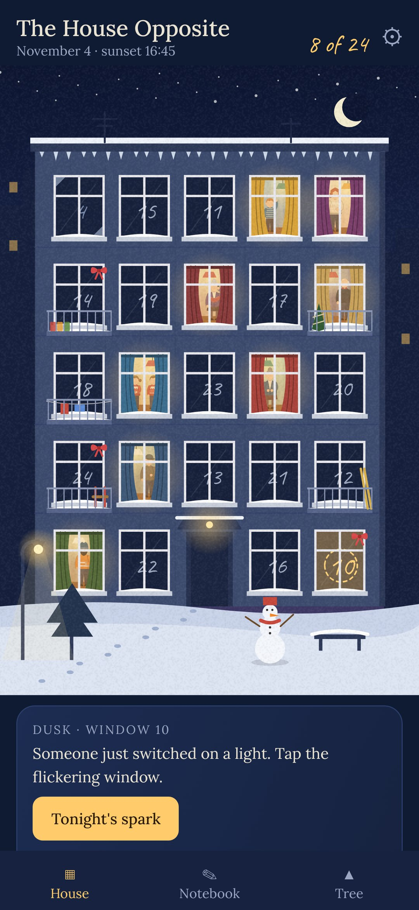
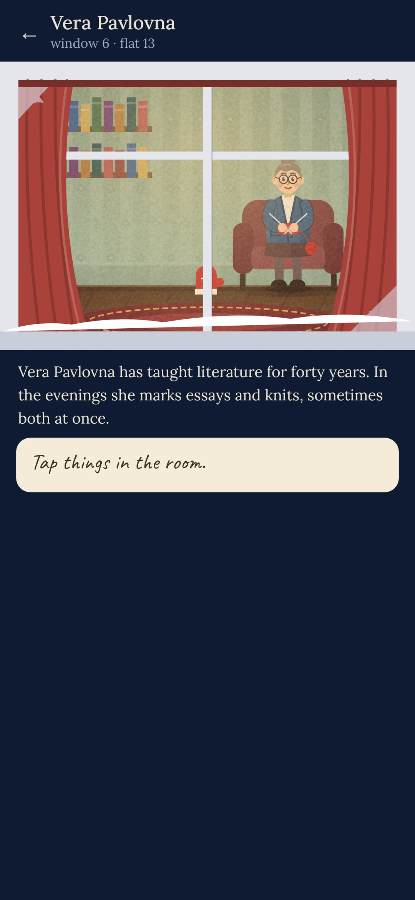
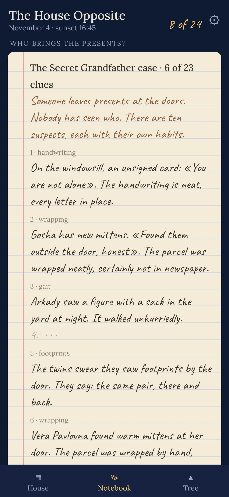
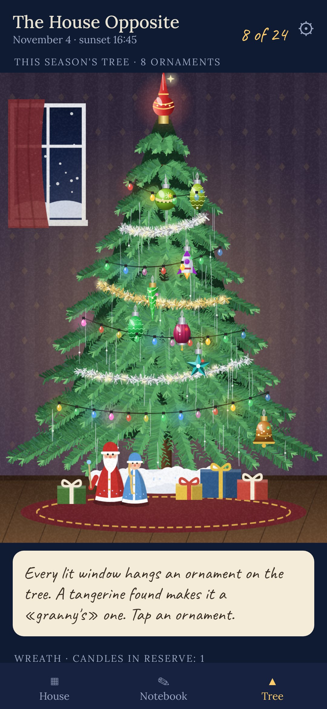

<div align="center">


# The House Opposite

### An advent calendar you can see from your window

*Across the yard stands a five-storey house with 24 dark windows. Every December evening, after the real sunset, one of them lights up — once you've done a small real deed of the day. Behind each window people live their December: a pianist, a nurse, twins, a postman on a pension, a cat called Bagel. And someone in the house leaves presents at the doors. Free, no ads, no accounts, no internet.*

[](https://github.com/bigdevwhale/opposite/actions/workflows/android.yml)
[](https://github.com/bigdevwhale/opposite/releases/latest)


[](LICENSE)

**English** · [Русский](README.ru.md) · [Changelog](CHANGELOG.md)

   

**[Download APK](https://github.com/bigdevwhale/opposite/releases/latest/download/TheHouseOpposite.apk)** · Android 9+ · first version

</div>

---

## How it works

- **A window a day.** Each evening has a small real task, a "spark": call someone you've been meaning to call, step into the yard after dark and stand there for five minutes. The window lights only after the real sunset in your town — you can't open tomorrow's today.
- **Rooms.** Every lit window opens into a drawn room with its people, their December story and things you can tap. Somewhere in the room hides a clue, and sometimes a mandarin.
- **The tree.** Each lit window hangs a glass ornament on your tree: a ball, an icicle, a rocket, a little house. A found mandarin makes it a "granny's" ornament with a gold cap.
- **Candles, not streaks.** Missed an evening? Relight the window with a candle. You earn a candle for a spark on a Sunday. Nothing burns down.
- **Sunset reminder.** An optional quiet note at dusk: "a window lit up across the yard".

## The Secret Grandfather

Someone in the house leaves presents at the doors. There are ten suspects, each with six habits: handwriting, wrapping, gait, smell, time of day, footprints. Every room gives a clue; early ones are vague and only narrow it down slowly, so the answer becomes certain around the 21st–23rd. Strike suspects out in the notebook, read their files, and name the culprit on the 24th. A wrong guess shows which clue contradicts it. The culprit changes from season to season, and each has their own ending.

## Real presents, if you like

As in an ordinary advent calendar, any window can hide a real present: something to find, a treat, a note or a deed. A bow marks the window, and the present shows in the room once it's lit. Making the calendar for someone dear? Switch to "for someone else": the list is sealed so they can't peek, and it says who it's from.

## Seasons

Start on December 1 or tonight — 24 evenings in a row work any time of year. When the season ends the tree goes up to the shelf, and next year there's a new mystery.

## Privacy

Everything stays on the phone. The app has no internet permission at all. Your rough location is used once, only if you allow it, to work out the sunset; without it the sunset is estimated from the time zone. See [PRIVACY.md](PRIVACY.md).

## Build

```
./gradlew assembleDebug                 # app.opposite.dev
./gradlew assembleDebug -Pdemo          # app.opposite.demo: a season ten evenings in, with presents
./gradlew testDebugUnitTest -Prender --tests '*RenderScreens*' && python tools/shots.py
python tools/icon.py                    # the launcher icon
```

Kotlin, Jetpack Compose; every picture — the house, rooms, people, the tree, ornaments — is drawn in code.

## Part of Stillcraft

[Stillcraft](https://bigdevwhale.github.io/stillcraft/) is a set of small, calm, free Android apps. Bugs and ideas: the buttons in Settings, or the [Telegram chat](https://t.me/+Q4gFEDk8O842OGVi).

MIT licence.
