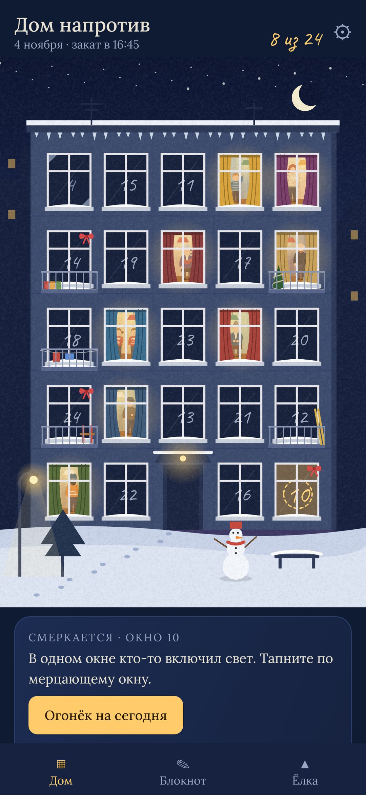
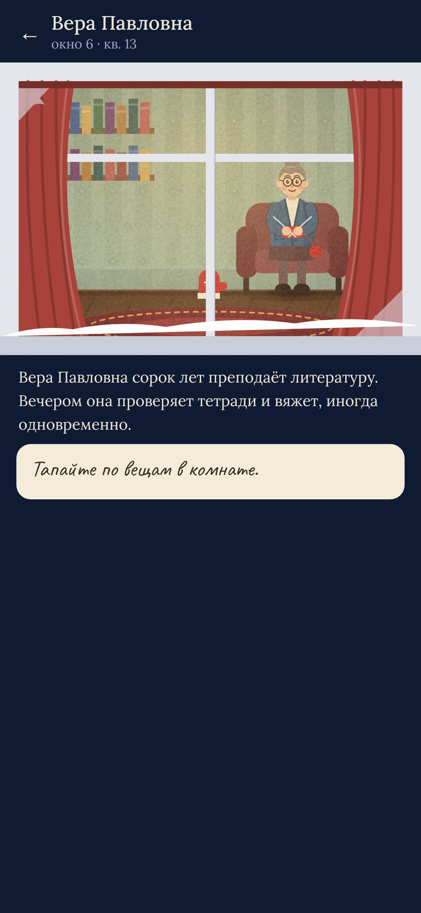
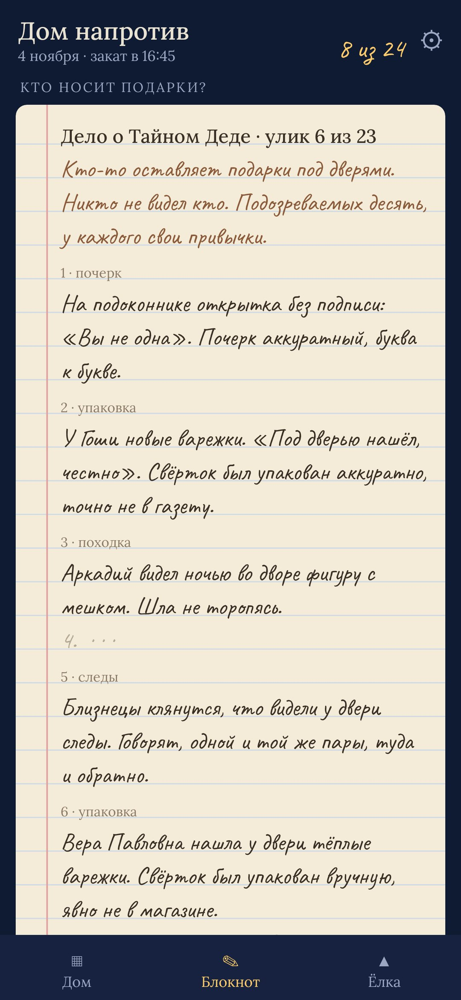
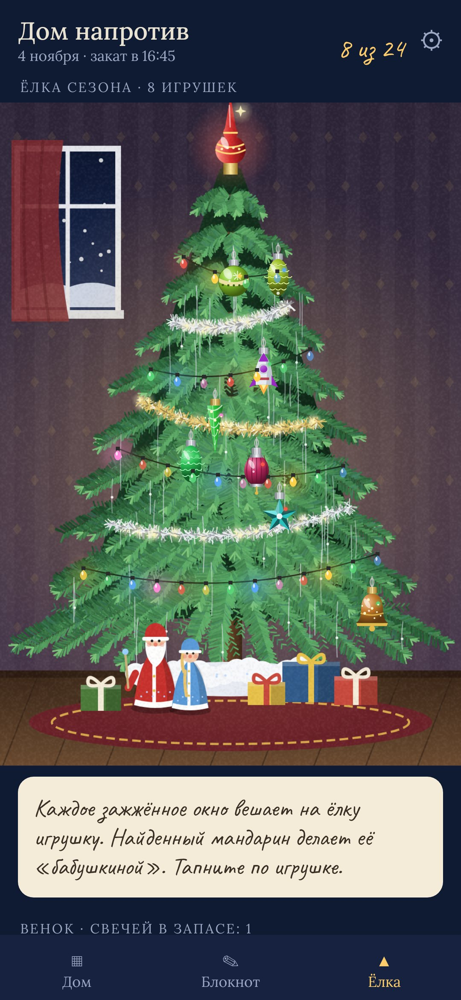

<div align="center">


# Дом напротив

### Адвент-календарь, который виден из окна

*Через двор стоит пятиэтажка, в ней 24 тёмных окна. Каждый декабрьский вечер, после настоящего заката, одно из них загорается, если вы сделали маленькое настоящее дело дня. За окнами живут люди: пианист, медсестра, близнецы, почтальон на пенсии, кот Бублик. А кто-то в доме оставляет подарки под дверями. Бесплатно, без рекламы, без аккаунтов и без интернета.*

[](https://github.com/bigdevwhale/opposite/actions/workflows/android.yml)
[](https://github.com/bigdevwhale/opposite/releases/latest)


[](LICENSE)

[English](README.md) · **Русский** · [Изменения](CHANGELOG.md)

   

**[Скачать APK](https://github.com/bigdevwhale/opposite/releases/latest/download/TheHouseOpposite.apk)** · Android 9+ · первая версия

</div>

---

## Как это устроено

- **Окно в день.** На каждый вечер есть маленькое настоящее дело — огонёк: позвонить тому, кому давно собирались, выйти во двор, когда стемнеет, и постоять пять минут. Окно загорается только после настоящего заката в вашем городе, так что завтрашнее сегодня не откроешь.
- **Комнаты.** За каждым горящим окном нарисована комната: жильцы, их декабрьская история, вещи, по которым можно тапать. Где-то в комнате спрятана улика, а иногда и мандарин.
- **Ёлка.** Каждое зажжённое окно вешает на вашу ёлку стеклянную игрушку: шар, сосульку, ракету, домик. Найденный мандарин делает игрушку «бабушкиной», с золотым колпачком.
- **Свечи вместо серий.** Пропустили вечер — зажгите окно свечой. Свеча прибавляется за огонёк в воскресенье. Ничего не сгорает.
- **Напоминание на закате.** По желанию: тихое «в доме напротив зажглось окно».

## Тайный Дед

Кто-то в доме оставляет подарки под дверями. Подозреваемых десять, у каждого шесть привычек: почерк, упаковка, походка, запах, время, следы. В каждой комнате есть улика. Первые улики расплывчатые и сужают круг медленно, так что ответ становится однозначным только к 21–23 декабря. В блокноте можно вычёркивать подозреваемых и читать их досье, а 24-го — назвать виновника. Если ошиблись, блокнот покажет, какая улика с этим не сходится. Виновник меняется от сезона к сезону, и у каждого свой финал.

## Настоящие подарки, если хочется

Как в обычном адвент-календаре, за любым окном можно спрятать настоящий подарок: что-то найти, сладкое, записку или дело. На окне появляется бантик, а подарок показывается в комнате, когда окно загорится. Готовите календарь для близкого — включите «готовлю для другого»: список запечатается, чтобы получатель не подсмотрел, и будет подписан, от кого он.

## Сезоны

Начать можно 1 декабря или прямо сегодня: 24 вечера подряд работают в любое время года. Когда сезон кончается, ёлка уезжает на антресоль, а в следующем году будет новая загадка.

## Приватность

Всё хранится только на телефоне. У приложения вообще нет доступа в интернет. Примерное место используется один раз и только с вашего разрешения, чтобы посчитать закат; без него закат считается по часовому поясу. Подробнее — в [PRIVACY.md](PRIVACY.md).

## Сборка

```
./gradlew assembleDebug                 # app.opposite.dev
./gradlew assembleDebug -Pdemo          # app.opposite.demo: десятый вечер сезона, с подарками
./gradlew testDebugUnitTest -Prender --tests '*RenderScreens*' && python tools/shots.py
python tools/icon.py                    # иконка
```

Kotlin, Jetpack Compose; все картинки — дом, комнаты, жильцы, ёлка, игрушки — нарисованы кодом.

## Часть Stillcraft

[Stillcraft](https://bigdevwhale.github.io/stillcraft/) — набор маленьких спокойных бесплатных приложений для Android. Ошибки и идеи — кнопками в настройках или в [чате в Telegram](https://t.me/+Q4gFEDk8O842OGVi).

Лицензия MIT.
